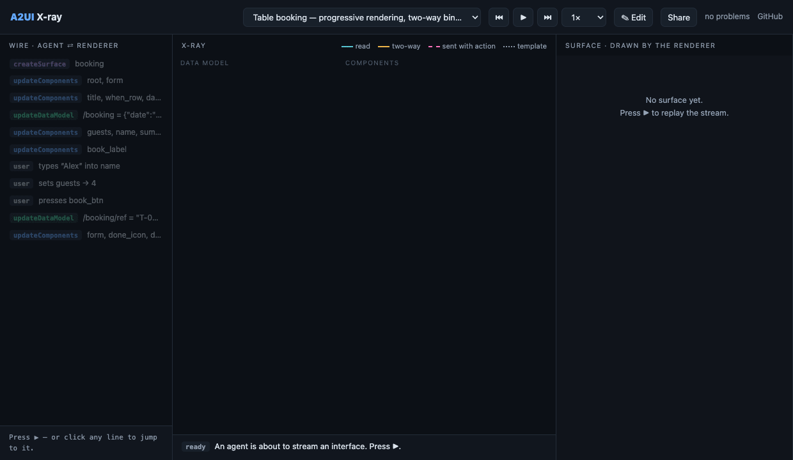
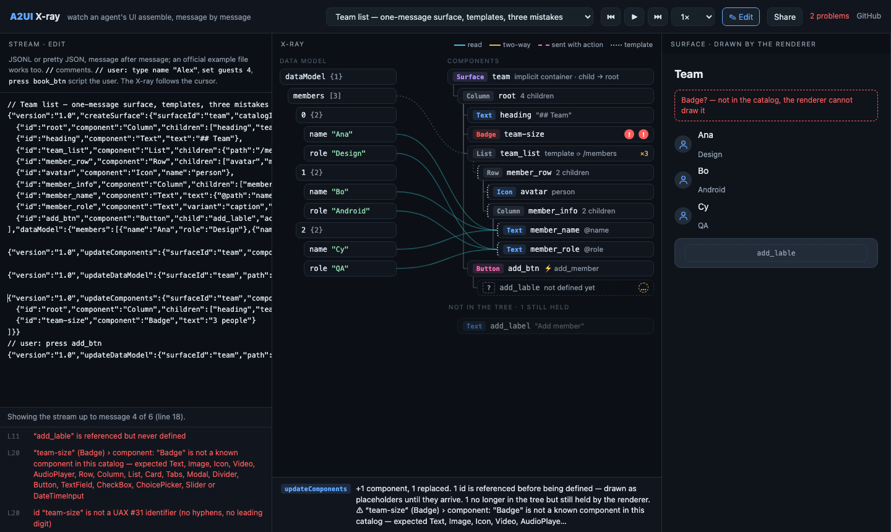

# A2UI X-ray

See how an [A2UI](https://a2ui.org) stream builds an interface, message by message: the data model, the component tree, the bindings between them, and the surface a renderer draws from them. Paste your own stream to check it against the official v1.0 schemas, and share it as a link.

**[Open it](https://alexeyw.github.io/a2ui-xray/)** · [a stream with mistakes, in the editor](https://alexeyw.github.io/a2ui-xray/?demo=1&edit=1&step=3)



*The booking demo played through, then a typo in the editor caught by the schema check. [Video (MP4)](docs/demo.mp4).*

In A2UI an agent does not send HTML. It sends a stream of JSON messages: components that refer to each other by id, and a data model they bind to. The renderer keeps both and draws the surface. Usually you see either the raw JSON or the finished screen. This page shows what lies between them.

It is one static page. Your stream stays in your browser and is not uploaded anywhere. A shared link carries the stream after `#`, and browsers do not send that part to a server.

## What you see

- **Wire**: the messages in order, coloured by type, with what the user did and the action that went back to the agent. The JSON of the current message is below.
- **X-ray**: the data model on the left, the components on the right, and cables between them:
  - teal: the component reads the value;
  - amber: an input reads it and writes it back;
  - pink, dashed: the value goes to the agent with an action;
  - grey, dotted: a list template repeats over it.

  A component that is referenced before it arrives is a dashed placeholder until it does. Components that left the tree but are still held by the renderer sit in a group below.
- **Surface**: a small renderer for the basic catalog. Type into it: the pulses show the local write and the components that refresh. Press a button: they show what goes to the agent.

Step with ⏮ ⏭ or the arrow keys, play and pause with the space bar, and click any message to jump to it. Hover a component to see its cables and what it drew.

## Check your own stream

Press **✎ Edit**. The wire becomes a text editor. Paste JSONL, pretty JSON (one message after another), or a whole example file from the A2UI repository, or drop a file on the page. The X-ray shows the stream up to the message under the cursor. Your stream is kept in the browser between visits.

Lines starting with `//` are comments. Three kinds of comment line act out the user:

```
// user: type name "Alex"
// user: set guests 4
// user: press book_btn
```

Problems are listed under the editor with their line. Click one to jump to the component.



What is checked:

- each message against the official v1.0 JSON Schemas (`agent_to_renderer.json`, `common_types.json` and the basic catalog). This catches unknown components and properties, missing required ones, wrong types, unknown functions and icon names. Each error names the component, for example `“name” (TextField) › lable: unknown property “lable”`;
- the stream as a whole: ids that are referenced but never defined, ids that are not identifiers (no hyphens), relative paths outside a template, data that components read but nobody sets, and a second `createSurface` for the same id.

For a surface on a custom catalog, only the envelope and the common types are checked, and its components are drawn as stubs.

## Share and embed

**Share** gives a link that opens the same stream, paused at the same message, and an `<iframe>` to put it in a page. The embed has no header, only a slim bar of controls. It starts playing when it is scrolled into view.

| Parameter | |
| --- | --- |
| `?demo=0` … `2` | a built-in stream |
| `?step=4` | open paused after that message (counting from 0) |
| `?edit=1` | open in the editor |
| `?theme=light` or `dark` | instead of the system theme |
| `?embed=1` | the embed layout |
| `?panels=xray,surface` | which panels to show: `wire`, `surface` (the X-ray is always shown) |
| `#s=…` | the stream itself, deflated; made by Share |

## Limits

- A2UI v1.0 only.
- The preview renderer covers the basic catalog and is not a reference renderer. Tabs, Modal, Video and AudioPlayer are drawn as stubs.
- Tested in Chrome on macOS. Not yet tried in Safari or Firefox.

## Tests

```bash
node tools/test_validate.js
```

It downloads the official v1.0 examples at the commit the schemas come from. It checks that every message passes (126 in 43 files), and that every mutation of them is caught: a renamed property, a dropped component name, a wrong type (282 mutations). It needs Node 18 or later.

`node tools/record_demo.mjs` records `docs/demo.gif` and `docs/demo.mp4` from the page served at `http://localhost:8791/`. It needs Chrome, ffmpeg and Node 22 or later.

## Third-party

`schemas.js` holds the A2UI v1.0 JSON Schemas from [a2ui-project/a2ui](https://github.com/a2ui-project/a2ui) at commit `524e4ea7acf9`, with descriptions removed by `tools/make_schemas.py`. The contact form demo is the example stream from the v1.0 specification. Both are under the Apache License 2.0, see [third_party/a2ui/LICENSE](third_party/a2ui/LICENSE).

This project is not affiliated with the A2UI project or with Google.

## License

MIT, see [LICENSE](LICENSE), for everything except the third-party files above.
